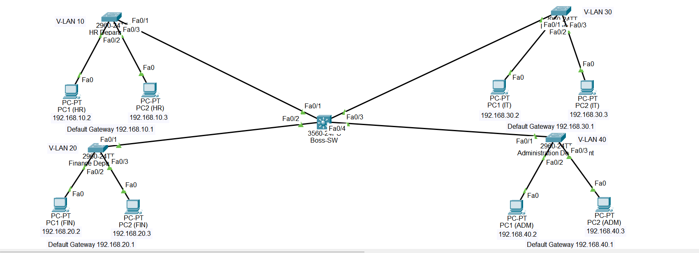

# Enterprise Network Design Using Cisco Packet Tracer

A multi-department enterprise network with VLAN segmentation, inter-VLAN routing on a Layer 3 switch, and centralized DHCP.

## Overview
This project simulates a small enterprise network connecting four departments: HR, Finance, IT, and Administration. Each department has its own VLAN, and the Layer 3 core switch routes traffic between them.

## Features
- VLAN-based network segmentation
- 802.1Q trunking between core and access switches
- Inter-VLAN routing using SVIs on a Layer 3 switch
- DHCP on the core switch for automatic IP allocation
- Reduced broadcast traffic and improved security through segmentation

## Addressing Plan
| Department | VLAN | Network | Gateway |
|------------|------|---------|---------|
| HR | 10 | 192.168.10.0/24 | 192.168.10.1 |
| Finance | 20 | 192.168.20.0/24 | 192.168.20.1 |
| IT | 30 | 192.168.30.0/24 | 192.168.30.1 |
| Admin | 40 | 192.168.40.0/24 | 192.168.40.1 |

## Devices
- 1 x Cisco 3560-24PS (Core / Layer 3 switch)
- 4 x Cisco 2960-24TT (Access switches)
- 8 x PCs (2 per department)

## Tools and Technologies
Cisco Packet Tracer, VLANs, 802.1Q Trunking, Inter-VLAN Routing, DHCP, TCP/IP

## How to Run
1. Install Cisco Packet Tracer.
2. Open `Enterprise_Network.pkt`.
3. Set each PC to DHCP (Desktop > IP Configuration).
4. Test connectivity with ping between departments.

## Verification
Screenshots of the verification commands are in the `screenshots` folder.

## Configuration Files
Device configurations are in the `configs` folder.

## What I Learned
- How VLANs and trunking work together
- Why `ip routing` is required on a Layer 3 switch
- Troubleshooting step by step using show commands

## Network Engineer 
Name: Muhammad Luqman,  
LinkedIn: linkedin.com/in/muhammad-luqman1
